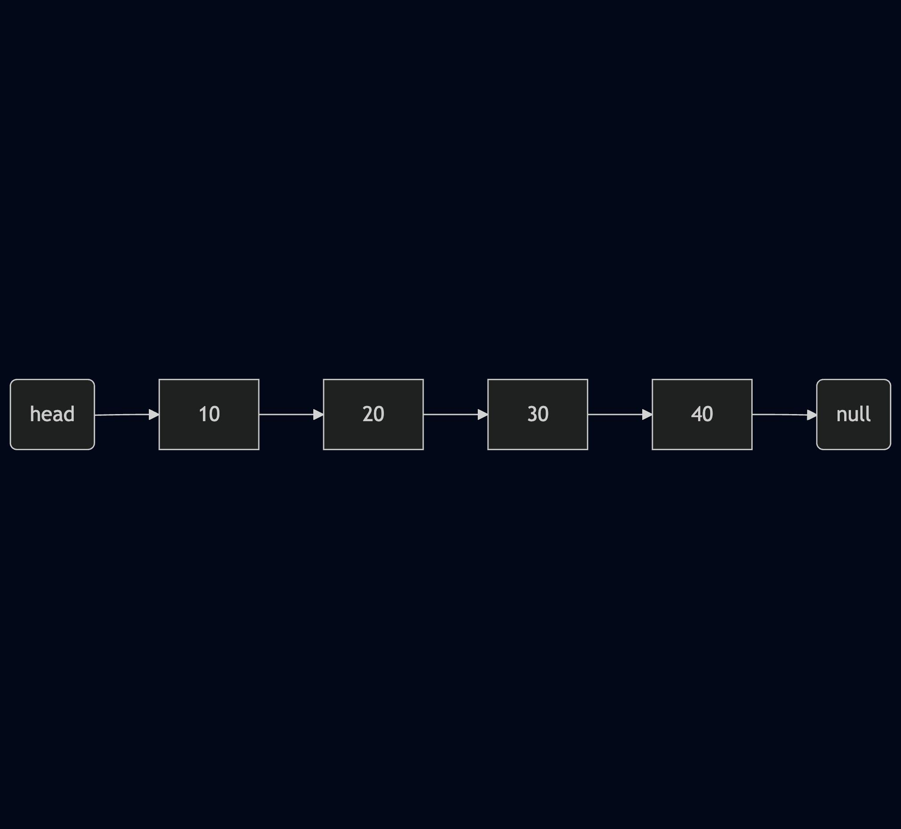

# Linked List in Java — Complete Guide

A linked list is a linear data structure in which elements, called nodes, are connected using references. Each node stores data and a reference to another node (or to the previous node as well, depending on the type of linked list).

Unlike an array, a linked list does not require its elements to occupy consecutive memory locations.

In Java, linked lists are important for understanding Data Structures and Algorithms (DSA), references, classes, objects, recursion, and time complexity.

We will learn linked lists from the fundamentals to implementation, operations, Java's built-in `LinkedList` class, and interview-level concepts.

## 1. What is a linked list?

Imagine that you want to store these integers:

`10, 20, 30, 40`
<p align="center">
  
</p>
Each node contains two things:

1. Data — the value stored in the node.
2. Next reference — a reference to the next node.

The first node is called the head, and the last node is called the tail when the list maintains a tail reference.

### Why is it called a linked list?

Because nodes are linked together through references.

The connection is logical rather than requiring the nodes to sit next to each other in memory.

## 2. What is a node in Java?

A node is an object representing one element of a linked list.

For example, a node can be represented using a Java class:

```java
class Node {
    int data;
    Node next;

    Node(int data) {
        this.data = data;
        this.next = null;
    }
}
```

Let's understand every line.

### `class Node`

```java
class Node {
}
```

This defines a class named `Node`. It acts as a blueprint for creating node objects.

### `int data`

```java
int data;
```

This instance variable stores the actual integer value of a node.

For example, a node may store `10`.

### `Node next`

```java
Node next;
```

This is the most important part.

- `Node` is the type of the variable.
- `next` is the variable name.
- It stores a reference to another `Node` object.

Notice that `next` is not an `int`. It refers to an object of type `Node`.

This is possible because Java allows a class to contain a reference to an object of its own class. This is called a self-referential class structure.

### Constructor

```java
Node(int data) {
    this.data = data;
    this.next = null;
}
```

When we create a node using:

```java
Node first = new Node(10);
```

Java creates a `Node` object whose `data` is `10` and whose `next` is `null`.

Here:

- `new Node(10)` creates an object.
- `first` stores a reference to that object.
- `this.data` refers to the current object's instance variable.
- `this.next = null` initializes its next reference to `null`.

Because `next` is a reference variable, its default value would already be `null`. We explicitly initialize it here to make the constructor's intention clear.

## 3. How do nodes connect to each other?

Let's create three node objects.

```java
Node first = new Node(10);
Node second = new Node(20);
Node third = new Node(30);
```

Initially, the nodes are independent. Each node's `next` reference is `null`.

Now connect them:

```java
first.next = second;
second.next = third;
```
<p align="center">
  
</p>
The statements work as follows:

```java
first.next = second;
```

This makes the first node's `next` reference point to the second node.

```java
second.next = third;
```

This makes the second node's `next` reference point to the third node.

**Important:** We are not copying the entire second node into the first node. We are assigning a reference to the second node object.

This is the same reference concept you encounter when working with objects and classes in Java OOP.

### What does `first.next.data` mean?

Consider:

```java
System.out.println(first.data);            // 10
System.out.println(first.next.data);       // 20
System.out.println(first.next.next.data);  // 30
```

Read the expressions from left to right:

- `first.data` — access the data in the first node.
- `first.next.data` — follow the first node's `next` reference, then access that node's data.
- `first.next.next.data` — follow two `next` references, then access the data.

If a reference is `null`, attempting to access a field through it causes a `NullPointerException`.

## 4. Complete linked list implementation in Java

Let's build our own singly linked list rather than using Java's built-in `LinkedList` class. This helps you understand how linked lists actually work.

The following program supports:

- Insertion at the beginning
- Insertion at the end
- Insertion at a particular index
- Deletion from the beginning
- Deletion from the end
- Deletion at a particular index
- Searching for an element
- Getting the size
- Displaying the list

```java
public class Main {

    // Represents one node in the linked list
    static class Node {
        int data;
        Node next;

        Node(int data) {
            this.data = data;
            this.next = null;
        }
    }

    // The linked list itself
    static class LinkedList {
        private Node head;
        private Node tail;
        private int size;

        // Insert at the beginning
        public void addFirst(int data) {
            Node node = new Node(data);

            node.next = head;
            head = node;

            if (tail == null) {
                tail = node;
            }

            size++;
        }

        // Insert at the end
        public void addLast(int data) {
            Node node = new Node(data);

            if (head == null) {
                head = node;
                tail = node;
            } else {
                tail.next = node;
                tail = node;
            }

            size++;
        }

        // Insert at a specified index
        public void add(int index, int data) {
            if (index < 0 || index > size) {
                throw new IndexOutOfBoundsException();
            }

            if (index == 0) {
                addFirst(data);
                return;
            }

            if (index == size) {
                addLast(data);
                return;
            }

            Node previous = head;

            for (int i = 0; i < index - 1; i++) {
                previous = previous.next;
            }

            Node node = new Node(data);
            node.next = previous.next;
            previous.next = node;

            size++;
        }

        // Delete from the beginning
        public int removeFirst() {
            if (head == null) {
                throw new IllegalStateException("List is empty");
            }

            int removed = head.data;
            head = head.next;
            size--;

            if (head == null) {
                tail = null;
            }

            return removed;
        }

        // Delete from the end
        public int removeLast() {
            if (head == null) {
                throw new IllegalStateException("List is empty");
            }

            if (head == tail) {
                return removeFirst();
            }

            Node previous = head;

            while (previous.next != tail) {
                previous = previous.next;
            }

            int removed = tail.data;
            previous.next = null;
            tail = previous;
            size--;

            return removed;
        }

        // Delete at a specified index
        public int remove(int index) {
            if (index < 0 || index >= size) {
                throw new IndexOutOfBoundsException();
            }

            if (index == 0) {
                return removeFirst();
            }

            Node previous = head;

            for (int i = 0; i < index - 1; i++) {
                previous = previous.next;
            }

            Node target = previous.next;
            previous.next = target.next;

            if (target == tail) {
                tail = previous;
            }

            size--;
            return target.data;
        }

        // Search for a value; return its index or -1
        public int indexOf(int target) {
            Node current = head;
            int index = 0;

            while (current != null) {
                if (current.data == target) {
                    return index;
                }

                current = current.next;
                index++;
            }

            return -1;
        }

        public int size() {
            return size;
        }

        public boolean isEmpty() {
            return head == null;
        }

        // Print every node
        public void display() {
            Node current = head;

            while (current != null) {
                System.out.print(current.data + " -> ");
                current = current.next;
            }

            System.out.println("null");
        }
    }

    public static void main(String[] args) {
        LinkedList list = new LinkedList();

        list.addFirst(20);
        list.addFirst(10);
        list.addLast(40);
        list.add(2, 30);

        list.display();
        // 10 -> 20 -> 30 -> 40 -> null

        System.out.println(list.size());       // 4
        System.out.println(list.indexOf(30));  // 2

        list.removeFirst();
        list.removeLast();
        list.remove(1);

        list.display();
        // 20 -> null
    }
}
```

### How the program works

The implementation uses three fields:

```java
private Node head;
private Node tail;
private int size;
```

- `head` references the first node.
- `tail` references the last node.
- `size` records how many nodes exist.

Initially, both `head` and `tail` are `null`, and `size` is `0`.

The `private` modifier prevents other classes from directly changing these fields. This protects the linked list's internal structure.

The `static` nested classes allow us to use `Node` and `LinkedList` from the static `main` method without first creating a `Main` object.

### A. Inserting at the beginning

```java
public void addFirst(int data) {
    Node node = new Node(data);

    node.next = head;
    head = node;

    if (tail == null) {
        tail = node;
    }

    size++;
}
```

Suppose the list is:

`20 -> 30 -> null`

We insert `10`.

<p align="center">
  
</p>

The key statements are:

```java
node.next = head;
head = node;
```

Why this order? First, preserve the connection to the old list. Then update the head. If you update `head` first, you can lose your easy reference to the old first node before connecting the new node to it.

If the list was empty, the new node becomes both `head` and `tail`.

**Time complexity:** \(O(1)\).

### B. Inserting at the end

```java
tail.next = node;
tail = node;
```

When the list is not empty, `tail` already identifies the last node. Therefore, we can connect the new node directly and update `tail`, without traversing the entire list.

If the list is empty, the new node becomes both `head` and `tail`.

**Time complexity:** \(O(1)\) when a tail reference is maintained.

### C. Inserting at an index

Suppose the list is:

`10 -> 20 -> 40 -> null`

We want to insert `30` at index `2`.

The important statements are:

```java
node.next = previous.next;
previous.next = node;
```

Before insertion, the `next` reference of node `20` points to node `40`.

First, make the new node point to `40`. Then make node `20` point to the new node.

The result is:

`10 -> 20 -> 30 -> 40 -> null`

The order matters because you need to preserve the reference to the rest of the list.

Finding the previous node takes up to \(O(n)\) time, although the pointer changes themselves take \(O(1)\).

### D. Deleting the first node

```java
head = head.next;
```

If the list is:

`10 -> 20 -> 30 -> null`

then `head = head.next` makes `head` reference node `20`.

Node `10` is no longer reachable through the list, so it can eventually be reclaimed by Java's garbage collector if no other references to it remain.

If the list becomes empty, `tail` must also be set to `null`.

**Time complexity:** \(O(1)\).

### E. Deleting the last node

This operation is more interesting.

For the list:

`10 -> 20 -> 30 -> null`

we need to find the node immediately before the tail. In a singly linked list, we cannot move backward from node `30`, because each node only points forward.

We therefore traverse from the head until:

```java
previous.next == tail
```
Then we perform:
```java
previous.next = null;
tail = previous;
```
The new tail is node `20`.
**Time complexity:** \(O(n)\), even though we maintain a tail reference. This is because the singly linked list does not maintain backward references.

### F. Traversing the list

```java
Node current = head;
while (current != null) {
    System.out.println(current.data);
    current = current.next;
}
```
Traversal means visiting nodes one by one.
The variable `current` moves from one node to the next. The loop ends when `current` becomes `null`.
**Important:** Moving `current` does not change `head`. They are separate reference variables.

## 5. How is a linked list stored in memory?
Consider these declarations:
```java
Node first = new Node(10);
Node second = new Node(20);
first.next = second;
```
Conceptually, Java references connect the objects like this:
<p align="center">
  
</p>

This is a conceptual diagram, not a literal memory layout. The JVM manages object allocation and reference representation.

Three important observations:

1. A reference variable stores a way to access an object, not the entire object itself.
2. Nodes need not occupy consecutive memory addresses.
3. A linked list is connected through references, so the nodes do not need array-style contiguous storage.

Java does not expose ordinary object memory addresses directly through its reference variables.

## 6. Linked List vs Array

| Feature | Array | Linked list |
|---|---|---|
| Access by index | \(O(1)\) | \(O(n)\) |
| Search by value | \(O(n)\) | \(O(n)\) |
| Insert at beginning | \(O(n)\) for shifting | \(O(1)\) |
| Delete at beginning | \(O(n)\) for shifting | \(O(1)\) |
| Insert at end | Usually \(O(1)\) amortized for a dynamic array | \(O(1)\) with a tail reference |
| Delete at end | \(O(1)\) for a typical dynamic array | \(O(n)\) for a singly linked list |
| Extra memory | Usually lower per element | Extra reference fields per node |
| Cache locality | Generally good | Generally poorer |
| Random access | Supported efficiently | Requires traversal |

The array comparison assumes an ordinary dynamic array such as Java's `ArrayList` for insertion and deletion. A fixed-size array cannot grow automatically.

### Why is array access \(O(1)\)?

Consider:

```java id="x0hkwv"
int[] arr = {10, 20, 30, 40};
System.out.println(arr[3]);
```

Java can access the fourth element directly using its index.

### Why is linked list access \(O(n)\)?

To access the fourth element of a singly linked list, you must follow the references from the head:

`head -> node 1 -> node 2 -> node 3 -> node 4`

You cannot directly jump to the fourth node by index.

### Is a linked list always faster for insertion and deletion?

No. This is a common interview misconception.

A linked list has \(O(1)\) insertion or deletion when you already have the appropriate node reference. If you must search for that node first, the complete operation can take \(O(n)\).

Arrays and `ArrayList` also benefit from better cache locality, which can make them faster in real-world workloads despite shifting elements.


# Linked List Patterns: Dummy Node, Head, and Tail

This is a very important pattern in Linked List problems, especially on LeetCode.

When a question says return the head and provides only `ListNode head` (without `tail`), you generally need to manipulate the linked list using references.

There are three common patterns.

## 1. When You Need to Create a New Linked List: Dummy Node

Use this when you are building a result linked list.

```java
ListNode dummy = new ListNode(-1);
ListNode tail = dummy;

// Add a new node
tail.next = new ListNode(10);
tail = tail.next;

// Add another node
tail.next = new ListNode(20);
tail = tail.next;

return dummy.next;
```

**Visual representation:**

```text
dummy
  |
  v
 -1 → 10 → 20 → null
```

Return `dummy.next`, not `dummy`.

**Why dummy?**

It eliminates the special condition for inserting the first node.

**Examples:**

- [LC 21 – Merge Two Sorted Lists](https://leetcode.com/problems/merge-two-sorted-lists/)
- [LC 86 – Partition List](https://leetcode.com/problems/partition-list/)

## 2. When Modifying the Existing Linked List: Use Head

If you only need to modify existing nodes, you generally don't need a dummy node.

**Example: Remove Duplicates (LC 83)**

```java
public ListNode deleteDuplicates(ListNode head) {

    if (head == null) {
        return head;
    }

    ListNode node = head;

    while (node.next != null) {

        if (node.val == node.next.val) {
            node.next = node.next.next;
        } else {
            node = node.next;
        }
    }

    return head;
}
```

Here:

- `head` maintains the starting reference.
- `node` traverses the linked list.
- You return `head` because the first node is still valid.

## 3. When the Head Itself Might Change: Use Dummy

Suppose you want to delete the first node.

**Original:**

```text
10 → 20 → 30 → null
```

**After deleting 10:**

```text
20 → 30 → null
```

If you use only `head`, you must update it:

```java
head = head.next;
return head;
```

Alternatively, use a dummy node:

```java
ListNode dummy = new ListNode(-1);
dummy.next = head;

ListNode prev = dummy;

prev.next = prev.next.next;

return dummy.next;
```

**Examples:**

- [LC 203 – Remove Linked List Elements](https://leetcode.com/problems/remove-linked-list-elements/)
- [LC 19 – Remove Nth Node From End of List](https://leetcode.com/problems/remove-nth-node-from-end-of-list/)

## 4. Your Quick Decision-Making Guide

| Situation | Pattern |
|---|---|
| Creating a new result list | Dummy + Tail |
| Modifying existing nodes | Head + Traversal pointer |
| First node might be deleted | Dummy node |
| Reversing a linked list | Previous + Current + Next |
| Merging two sorted lists | Dummy + Tail |

## Important Concept

Even if LeetCode doesn't provide `tail`, you can create your own:

```java
ListNode dummy = new ListNode(-1);
ListNode tail = dummy;
```

`tail` is simply a reference that you maintain yourself. It does not have to be a member variable of a Linked List class.


# Cycle Detection in a Linked List (Floyd's Cycle Detection Algorithm)

Cycle detection is one of the most important patterns in Linked List problems, especially in DSA interviews and LeetCode.

Let's understand it from the basics, using Java, with diagrams, dry runs, and code.

## 1. First, What Is a Cycle in a Linked List?

Normally, a singly linked list looks like this:

)

Each node points to the next node, and the last node points to `null`.

But sometimes, the last node points back to an already existing node instead of pointing to `null`.

This creates a cycle (loop).


[Source: TutorialHorizon – Linked List Cycle Detection](https://tutorialhorizon.com/algorithms/linked-list-cycle-detection-tortoise-and-hare-algorithm/)

For example:

```text
10 → 20 → 30 → 40 → 50
      ↑              |
      |______________|
```

Here:

- Node 10 points to 20.
- Node 20 points to 30.
- Node 30 points to 40.
- Node 40 points to 50.
- Node 50 points back to 20.

Notice: There is no `null` at the end.

Therefore, if we traverse this linked list normally, we will never reach `null`. The traversal will continue infinitely.

This is called a cycle.

## 2. How Do We Detect a Cycle?

There are two common approaches.

| Approach | Time Complexity | Space Complexity |
|---|---|---|
| HashSet | O(n) | O(n) |
| Floyd's Algorithm | O(n) | O(1) |

We'll focus on Floyd's Cycle Detection Algorithm because it is the optimal approach.

## 3. Floyd's Cycle Detection Algorithm (Slow and Fast Pointers)

The main idea is very simple.

We use two pointers:

1. **Slow pointer:** Moves one node at a time.
2. **Fast pointer:** Moves two nodes at a time.

```java
slow = slow.next;
fast = fast.next.next;
```

Now, there are two possibilities.

**Case 1: No cycle exists**

Eventually, the fast pointer reaches `null` (or its next node is `null`).

**Case 2: A cycle exists**

The fast pointer will eventually meet the slow pointer.

**Why?**

Imagine two people running on a circular track:

- Person A runs 1 step at a time.
- Person B runs 2 steps at a time.

Eventually, the faster person catches the slower person.

The same principle works in a circular linked list.

## 4. Dry Run with an Example

Consider this linked list:

```text
10 → 20 → 30 → 40 → 50
      ↑              |
      |______________|
```

Initially:

```java
slow = head;
fast = head;
```

**Initial position:**

- Slow = 10
- Fast = 10

**Movement:**

| Step | Slow | Fast |
|---|---:|---:|
| 0 | 10 | 10 |
| 1 | 20 | 30 |
| 2 | 30 | 50 |
| 3 | 40 | 30 |
| 4 | 50 | 50 |

<badge color="success">Cycle detected at node 50</badge>

Both pointers meet at node 50.

The important observation is:

```java
slow == fast
```

When both pointers reference the same node, a cycle exists.

**Important:** We compare node references, not node values.

## 5. Java Implementation (LeetCode 141)

Linked List Cycle asks us to determine whether a linked list contains a cycle.

```java
public class Solution {

    public boolean hasCycle(ListNode head) {

        ListNode slow = head;
        ListNode fast = head;

        while (fast != null && fast.next != null) {

            slow = slow.next;
            fast = fast.next.next;

            if (slow == fast) {
                return true;
            }
        }

        return false;
    }
}
```

### Let's Understand Every Important Line

**1. Initialize both pointers**

```java
ListNode slow = head;
ListNode fast = head;
```

Both pointers initially point to the first node.

**2. The while condition**

```java
while (fast != null && fast.next != null)
```

Why do we need two conditions?

- `fast != null`: Ensures fast itself exists.
- `fast.next != null`: Ensures fast can move two steps ahead.

Without these checks, we might get a `NullPointerException`.

**3. Move the pointers**

```java
slow = slow.next;
fast = fast.next.next;
```

Slow moves one step, and fast moves two steps.

**4. Check whether they meet**

```java
if (slow == fast) {
    return true;
}
```

If both references point to the same node, the cycle exists.

**5. Return false**

```java
return false;
```

If fast reaches `null`, no cycle exists.

## 6. Why Does the Fast Pointer Always Catch the Slow Pointer?

This is an important interview question.

Suppose both pointers enter a cycle.

- Slow moves 1 step.
- Fast moves 2 steps.

Therefore, the relative distance between them decreases by one node on every iteration (considering the circular distance).

Eventually, the distance becomes zero, meaning both pointers meet.

That's why Floyd's algorithm works.

## 7. Complexity Analysis

| Complexity | Value | Reason |
|---|---|---|
| Time | O(n) | Pointers traverse the linked list |
| Space | O(1) | Only two pointers are used |

This is better than the HashSet approach in terms of auxiliary space.


# Cycle Detection in a Linked List (Floyd's Cycle Detection Algorithm)

Cycle detection is one of the most important patterns in Linked List problems, especially in DSA interviews and LeetCode.

Let's understand it from the basics, using Java, with diagrams, dry runs, and code.

## 1. First, What Is a Cycle in a Linked List?

Normally, a singly linked list looks like this:

)

Each node points to the next node, and the last node points to `null`.

But sometimes, the last node points back to an already existing node instead of pointing to `null`.

This creates a cycle (loop).


[Source: TutorialHorizon – Linked List Cycle Detection](https://tutorialhorizon.com/algorithms/linked-list-cycle-detection-tortoise-and-hare-algorithm/)

For example:

```text
10 → 20 → 30 → 40 → 50
      ↑              |
      |______________|
```

Here:

- Node 10 points to 20.
- Node 20 points to 30.
- Node 30 points to 40.
- Node 40 points to 50.
- Node 50 points back to 20.

Notice: There is no `null` at the end.

Therefore, if we traverse this linked list normally, we will never reach `null`. The traversal will continue infinitely.

This is called a cycle.

## 2. How Do We Detect a Cycle?

There are two common approaches.

| Approach | Time Complexity | Space Complexity |
|---|---|---|
| HashSet | O(n) | O(n) |
| Floyd's Algorithm | O(n) | O(1) |

We'll focus on Floyd's Cycle Detection Algorithm because it is the optimal approach.

## 3. Floyd's Cycle Detection Algorithm (Slow and Fast Pointers)

The main idea is very simple.

We use two pointers:

1. **Slow pointer:** Moves one node at a time.
2. **Fast pointer:** Moves two nodes at a time.

```java
slow = slow.next;
fast = fast.next.next;
```

Now, there are two possibilities.

**Case 1: No cycle exists**

Eventually, the fast pointer reaches `null` (or its next node is `null`).

**Case 2: A cycle exists**

The fast pointer will eventually meet the slow pointer.

**Why?**

Imagine two people running on a circular track:

- Person A runs 1 step at a time.
- Person B runs 2 steps at a time.

Eventually, the faster person catches the slower person.

The same principle works in a circular linked list.

## 4. Dry Run with an Example

Consider this linked list:

```text
10 → 20 → 30 → 40 → 50
      ↑              |
      |______________|
```

Initially:

```java
slow = head;
fast = head;
```

**Initial position:**

- Slow = 10
- Fast = 10

**Movement:**

| Step | Slow | Fast |
|---|---:|---:|
| 0 | 10 | 10 |
| 1 | 20 | 30 |
| 2 | 30 | 50 |
| 3 | 40 | 30 |
| 4 | 50 | 50 |

<badge color="success">Cycle detected at node 50</badge>

Both pointers meet at node 50.

The important observation is:

```java
slow == fast
```

When both pointers reference the same node, a cycle exists.

**Important:** We compare node references, not node values.

## 5. Java Implementation (LeetCode 141)

Linked List Cycle asks us to determine whether a linked list contains a cycle.

```java
public class Solution {

    public boolean hasCycle(ListNode head) {

        ListNode slow = head;
        ListNode fast = head;

        while (fast != null && fast.next != null) {

            slow = slow.next;
            fast = fast.next.next;

            if (slow == fast) {
                return true;
            }
        }

        return false;
    }
}
```

### Let's Understand Every Important Line

**1. Initialize both pointers**

```java
ListNode slow = head;
ListNode fast = head;
```

Both pointers initially point to the first node.

**2. The while condition**

```java
while (fast != null && fast.next != null)
```

Why do we need two conditions?

- `fast != null`: Ensures fast itself exists.
- `fast.next != null`: Ensures fast can move two steps ahead.

Without these checks, we might get a `NullPointerException`.

**3. Move the pointers**

```java
slow = slow.next;
fast = fast.next.next;
```

Slow moves one step, and fast moves two steps.

**4. Check whether they meet**

```java
if (slow == fast) {
    return true;
}
```

If both references point to the same node, the cycle exists.

**5. Return false**

```java
return false;
```

If fast reaches `null`, no cycle exists.

## 6. Why Does the Fast Pointer Always Catch the Slow Pointer?

This is an important interview question.

Suppose both pointers enter a cycle.

- Slow moves 1 step.
- Fast moves 2 steps.

Therefore, the relative distance between them decreases by one node on every iteration (considering the circular distance).

Eventually, the distance becomes zero, meaning both pointers meet.

That's why Floyd's algorithm works.

## 7. Complexity Analysis

| Complexity | Value | Reason |
|---|---|---|
| Time | O(n) | Pointers traverse the linked list |
| Space | O(1) | Only two pointers are used |

This is better than the HashSet approach in terms of auxiliary space.


# Linked List Cycle II (LeetCode 142) – Find the Starting Node of a Cycle

In LeetCode 142, we don't just detect whether a cycle exists; we have to find the exact node where the cycle begins.

This requires one additional step after detecting the cycle using Floyd's algorithm.

## 1. Understand the Example

Consider this linked list:

```text
10 → 20 → 30 → 40 → 50
      ↑              |
      |______________|
```

Here:

- Head = 10
- Cycle starts at node 20.
- Both slow and fast eventually meet at node 50.

Our objective is to return node 20, not node 50.

## 2. The Additional Step

Once slow and fast meet:

1. Move the `slow` pointer back to `head`.
2. Keep the `fast` pointer at the meeting point.
3. Now move BOTH pointers one step at a time.
4. The node where they meet again is the starting node of the cycle.


[Source: Nick Li – LeetCode 142](https://nicklee1006.github.io/Leetcode-142-Linked-List-Cycle-II/)

**The logic:**

```java
slow = head;

while (slow != fast) {
    slow = slow.next;
    fast = fast.next;
}

return slow;
```

## 3. Complete Java Code (LeetCode 142)

```java
public class Solution {

    public ListNode detectCycle(ListNode head) {

        ListNode slow = head;
        ListNode fast = head;

        // Step 1: Detect cycle
        while (fast != null && fast.next != null) {

            slow = slow.next;
            fast = fast.next.next;

            // Step 2: Find the meeting point
            if (slow == fast) {

                // Step 3: Reset slow to head
                slow = head;

                // Step 4: Move both one step at a time
                while (slow != fast) {
                    slow = slow.next;
                    fast = fast.next;
                }

                // Step 5: Return cycle starting node
                return slow;
            }
        }

        return null;
    }
}
```

## 4. Why Does This Work Mathematically?

Let's understand the mathematical reasoning.

Suppose:

- `L` = Distance from head to cycle starting node.
- `C` = Distance from cycle starting node to meeting point.
- `K` = Length of the entire cycle.

When slow and fast meet:

- Slow travels: \(L+C\)
- Fast travels: \(2(L+C)\)

Since fast travels twice the distance:

\[
2(L+C)-(L+C)=L+C
\]

The difference is a multiple of the cycle length:

\[
L+C=nK
\]

Therefore:

\[
L=nK-C
\]

This means that if one pointer starts from the head and another starts from the meeting point, moving both one step at a time makes them meet at the cycle entrance.

## 5. Important Difference Between LC 141 and LC 142

| Feature | LC 141 | LC 142 |
|---|---|---|
| Detect cycle | Yes | Yes |
| Find cycle starting node | No | Yes |
| Floyd's algorithm | Yes | Yes |
| Additional pointer movement | No | Yes |
| Return type | `boolean` | `ListNode` |


# LeetCode 82 – Remove Duplicates from Sorted List II

## Recommended Approach: Dummy Node + Two Pointers

The easiest way to solve LC 82 is to use a dummy node.

**Consider:**

```text
1 → 2 → 3 → 3 → 4 → 4 → 5
```

**Expected output:**

```text
1 → 2 → 5 → null
```

**Why?**

- 1 appears once → Keep.
- 2 appears once → Keep.
- 3 appears twice → Remove both.
- 4 appears twice → Remove both.
- 5 appears once → Keep.

## 3. Java Solution (LeetCode 82)

```java
class Solution {

    public ListNode deleteDuplicates(ListNode head) {

        ListNode dummy = new ListNode(-1);
        dummy.next = head;

        ListNode prev = dummy;
        ListNode curr = head;

        while (curr != null) {

            // Check whether current value is duplicated
            if (curr.next != null && curr.val == curr.next.val) {

                // Skip all nodes having the same value
                while (curr.next != null &&
                       curr.val == curr.next.val) {

                    curr = curr.next;
                }

                // Remove the entire duplicate group
                prev.next = curr.next;

            } else {

                // Current value is unique
                prev = prev.next;
            }

            curr = curr.next;
        }

        return dummy.next;
    }
}
```

## Pointer Responsibilities

### `prev` (Previous Pointer)

Points to the last node that we know is unique and should remain in the final linked list.

### `curr` (Current Pointer)

Checks the current node and identifies whether its value is duplicated.


# LeetCode 82 – Remove Duplicates from Sorted List II: Complete Dry Run

Let's dry-run your LeetCode 82 – Remove Duplicates from Sorted List II code with the input:

```text
1 → 2 → 3 → 3 → 4 → 4 → 5 → null
```

**Expected output:**

```text
1 → 2 → 5 → null
```

We'll track three pointers/variables:

- `dummy`: A node before the head.
- `prev`: Points to the last node confirmed to be unique.
- `curr`: Used to traverse the linked list.

# 1. Initial Setup

Execute:

```java
ListNode dummy = new ListNode(-1);
dummy.next = head;

ListNode prev = dummy;
ListNode curr = head;
```

Our initial structure:

```text
dummy → 1 → 2 → 3 → 3 → 4 → 4 → 5 → null
  ↑      ↑
 prev   curr
```

| Variable | Points to |
|---|---|
| `dummy` | -1 |
| `prev` | -1 |
| `curr` | 1 |

# 2. Complete Dry Run

## Iteration 1: curr = 1

Current structure:

```text
dummy → 1 → 2 → 3 → 3 → 4 → 4 → 5
  ↑      ↑
 prev   curr
```

Check:

```java
if (curr.next != null && curr.val == curr.next.val)
```

Substitute values:

```java
if (1 == 2)  // false
```

Since 1 is unique, execute:

```java
prev = prev.next;
```

Now:

```text
dummy → 1 → 2 → 3 → 3 → 4 → 4 → 5
         ↑   ↑
        prev curr
```

Updated pointers:

- `prev = 1`
- `curr = 1` (temporarily, before the final statement)

Then execute:

```java
curr = curr.next;
```

Now `curr = 2`.

**Node 1 retained.**

## Iteration 2: curr = 2

Current structure:

```text
dummy → 1 → 2 → 3 → 3 → 4 → 4 → 5
         ↑   ↑
        prev curr
```

Check:

```java
if (2 == 3) // false
```

Node 2 is unique.

Execute:

```java
prev = prev.next;
```

Now:

```text
dummy → 1 → 2 → 3 → 3 → 4 → 4 → 5
             ↑   ↑
            prev curr
```

Then:

```java
curr = curr.next;
```

Now `curr = 3`.

**Node 2 retained.**

## Iteration 3: curr = 3

Current structure:

```text
dummy → 1 → 2 → 3 → 3 → 4 → 4 → 5
             ↑   ↑
            prev curr
```

Check:

```java
if (3 == 3) // true
```

We found a duplicate!

Now execute the inner while loop:

```java
while (curr.next != null &&
       curr.val == curr.next.val) {

    curr = curr.next;
}
```

Let's understand this carefully.

**First inner iteration:**

```java
3 == 3 // true
```

Move:

```java
curr = curr.next;
```

Now `curr` points to the second 3.

```text
dummy → 1 → 2 → 3 → 3 → 4 → 4 → 5
             ↑       ↑
            prev    curr
```

Check the inner condition again:

```java
3 == 4 // false
```

The inner loop terminates.

Now `curr` points to the last node containing 3.

**Duplicate group identified: 3, 3**

## Iteration 3 Continued: Remove the Duplicate Group

Execute:

```java
prev.next = curr.next;
```

Let's understand the references:

Before:

```text
dummy → 1 → 2 → 3 → 3 → 4 → 4 → 5
             ↑       ↑
            prev    curr
```

Here:

- `prev` points to node 2.
- `curr` points to the second node 3.
- `curr.next` points to node 4.

We execute:

```java
prev.next = curr.next;
```

This means:

```java
node2.next = node4;
```

After:

```text
dummy → 1 → 2 ─────────→ 4 → 4 → 5
             ↑           ↑
            prev        curr
```

Both nodes containing 3 are now disconnected from the linked list.

**Important:** Notice that `prev` did not move. It remains at node 2 because we haven't confirmed that the next value (4) is unique yet.

Finally:

```java
curr = curr.next;
```

Now `curr` moves from the second 3 to node 4.

**Both nodes containing 3 removed.**

## Iteration 4: curr = 4

Current structure:

```text
dummy → 1 → 2 → 4 → 4 → 5
             ↑   ↑
            prev curr
```

Check:

```java
if (4 == 4) // true
```

Another duplicate group!

Execute the inner while loop:

```java
while (curr.next != null &&
       curr.val == curr.next.val) {

    curr = curr.next;
}
```

**First check:**

```java
4 == 4 // true
```

Move `curr` to the second 4.

```text
dummy → 1 → 2 → 4 → 4 → 5
             ↑       ↑
            prev    curr
```

Check again:

```java
4 == 5 // false
```

The inner loop stops.

Now execute:

```java
prev.next = curr.next;
```

This means:

```java
node2.next = node5;
```

After removing both 4s:

```text
dummy → 1 → 2 ─────────→ 5
             ↑           ↑
            prev        curr
```

Finally:

```java
curr = curr.next;
```

Now `curr = 5`.

**Both nodes containing 4 removed.**

## Iteration 5: curr = 5

Current structure:

```text
dummy → 1 → 2 → 5
             ↑   ↑
            prev curr
```

Check:

```java
if (5 == null) // Cannot compare this way
```

Actually, the condition evaluates as follows:

```java
curr.next != null
```

Since `curr.next == null`, the condition is false.

Node 5 is unique.

Execute:

```java
prev = prev.next;
```

Now:

```text
dummy → 1 → 2 → 5
                 ↑
                prev
                curr (temporarily)
```

Finally:

```java
curr = curr.next;
```

Now `curr = null`.

The outer while loop terminates.

# 3. Complete Iteration Summary

| Iteration | curr value | Duplicate? | Operation |
|---|---:|---|---|
| 1 | 1 | No | Move prev |
| 2 | 2 | No | Move prev |
| 3 | 3 | Yes | Remove both 3s |
| 4 | 4 | Yes | Remove both 4s |
| 5 | 5 | No | Move prev |

**Final output:**

```text
1 → 2 → 5 → null
```

**Original nodes:** 7

**Removed nodes:** 4

**Remaining nodes:** 3

# 4. The Most Important Concept: Why Don't We Move `prev` When Duplicates Are Found?

This is the key to understanding LC 82.

Consider:

```text
1 → 2 → 3 → 3 → 4
```

When we find duplicate 3s:

```java
prev.next = curr.next;
```

We connect node 2 directly to node 4.

Why don't we move `prev` to node 4?

Because we haven't checked whether 4 is also duplicated!

If 4 is duplicated, we must remove it too.

Therefore:

- If the current value is unique, move `prev`.
- If the current value is duplicated, keep `prev` where it is.
- Always move `curr` forward after processing the current group.

This is the fundamental pointer-management idea behind this solution.
