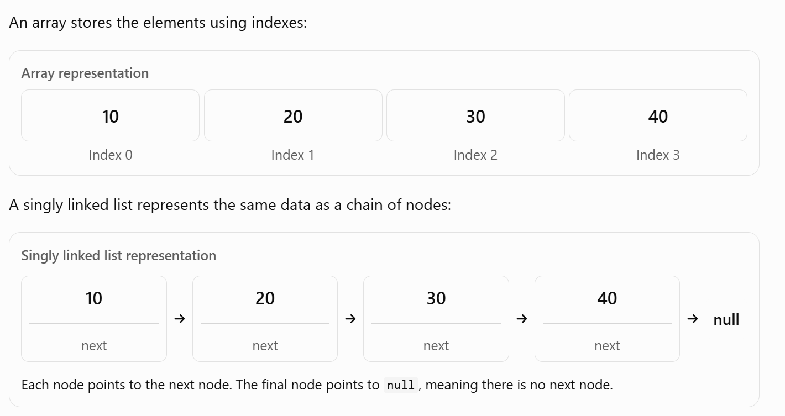
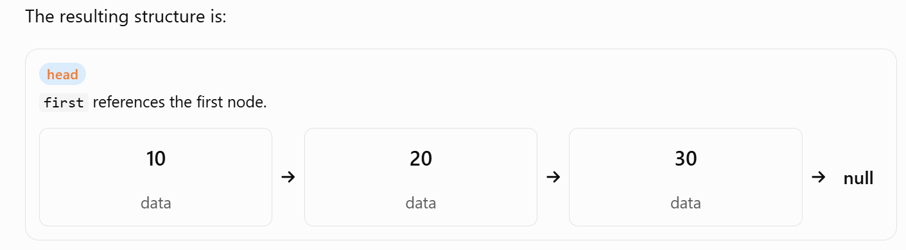
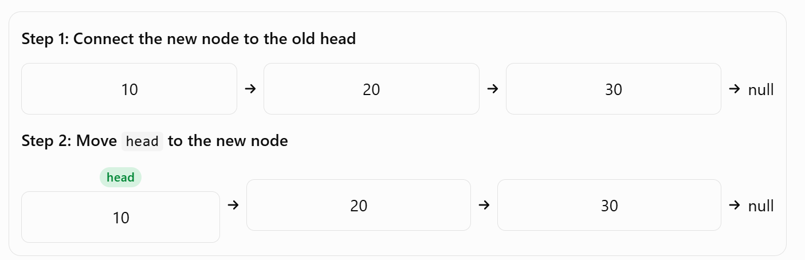
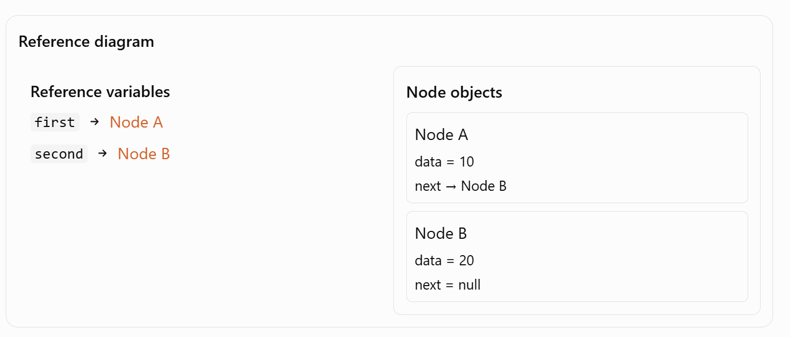

# Linked List in Java — Complete Guide

A linked list is a linear data structure in which elements, called nodes, are connected using references. Each node stores data and a reference to another node (or to the previous node as well, depending on the type of linked list).

Unlike an array, a linked list does not require its elements to occupy consecutive memory locations.

In Java, linked lists are important for understanding Data Structures and Algorithms (DSA), references, classes, objects, recursion, and time complexity.

We will learn linked lists from the fundamentals to implementation, operations, Java's built-in `LinkedList` class, and interview-level concepts.

## 1. What is a linked list?

Imagine that you want to store these integers:

`10, 20, 30, 40`
<p align="center">
  
</p>
Each node contains two things:

1. Data — the value stored in the node.
2. Next reference — a reference to the next node.

The first node is called the head, and the last node is called the tail when the list maintains a tail reference.

### Why is it called a linked list?

Because nodes are linked together through references.

The connection is logical rather than requiring the nodes to sit next to each other in memory.

## 2. What is a node in Java?

A node is an object representing one element of a linked list.

For example, a node can be represented using a Java class:

```java
class Node {
    int data;
    Node next;

    Node(int data) {
        this.data = data;
        this.next = null;
    }
}
```

Let's understand every line.

### `class Node`

```java
class Node {
}
```

This defines a class named `Node`. It acts as a blueprint for creating node objects.

### `int data`

```java
int data;
```

This instance variable stores the actual integer value of a node.

For example, a node may store `10`.

### `Node next`

```java
Node next;
```

This is the most important part.

- `Node` is the type of the variable.
- `next` is the variable name.
- It stores a reference to another `Node` object.

Notice that `next` is not an `int`. It refers to an object of type `Node`.

This is possible because Java allows a class to contain a reference to an object of its own class. This is called a self-referential class structure.

### Constructor

```java
Node(int data) {
    this.data = data;
    this.next = null;
}
```

When we create a node using:

```java
Node first = new Node(10);
```

Java creates a `Node` object whose `data` is `10` and whose `next` is `null`.

Here:

- `new Node(10)` creates an object.
- `first` stores a reference to that object.
- `this.data` refers to the current object's instance variable.
- `this.next = null` initializes its next reference to `null`.

Because `next` is a reference variable, its default value would already be `null`. We explicitly initialize it here to make the constructor's intention clear.

## 3. How do nodes connect to each other?

Let's create three node objects.

```java
Node first = new Node(10);
Node second = new Node(20);
Node third = new Node(30);
```

Initially, the nodes are independent. Each node's `next` reference is `null`.

Now connect them:

```java
first.next = second;
second.next = third;
```
<p align="center">
  
</p>
The statements work as follows:

```java
first.next = second;
```

This makes the first node's `next` reference point to the second node.

```java
second.next = third;
```

This makes the second node's `next` reference point to the third node.

**Important:** We are not copying the entire second node into the first node. We are assigning a reference to the second node object.

This is the same reference concept you encounter when working with objects and classes in Java OOP.

### What does `first.next.data` mean?

Consider:

```java
System.out.println(first.data);            // 10
System.out.println(first.next.data);       // 20
System.out.println(first.next.next.data);  // 30
```

Read the expressions from left to right:

- `first.data` — access the data in the first node.
- `first.next.data` — follow the first node's `next` reference, then access that node's data.
- `first.next.next.data` — follow two `next` references, then access the data.

If a reference is `null`, attempting to access a field through it causes a `NullPointerException`.

## 4. Complete linked list implementation in Java

Let's build our own singly linked list rather than using Java's built-in `LinkedList` class. This helps you understand how linked lists actually work.

The following program supports:

- Insertion at the beginning
- Insertion at the end
- Insertion at a particular index
- Deletion from the beginning
- Deletion from the end
- Deletion at a particular index
- Searching for an element
- Getting the size
- Displaying the list

```java
public class Main {

    // Represents one node in the linked list
    static class Node {
        int data;
        Node next;

        Node(int data) {
            this.data = data;
            this.next = null;
        }
    }

    // The linked list itself
    static class LinkedList {
        private Node head;
        private Node tail;
        private int size;

        // Insert at the beginning
        public void addFirst(int data) {
            Node node = new Node(data);

            node.next = head;
            head = node;

            if (tail == null) {
                tail = node;
            }

            size++;
        }

        // Insert at the end
        public void addLast(int data) {
            Node node = new Node(data);

            if (head == null) {
                head = node;
                tail = node;
            } else {
                tail.next = node;
                tail = node;
            }

            size++;
        }

        // Insert at a specified index
        public void add(int index, int data) {
            if (index < 0 || index > size) {
                throw new IndexOutOfBoundsException();
            }

            if (index == 0) {
                addFirst(data);
                return;
            }

            if (index == size) {
                addLast(data);
                return;
            }

            Node previous = head;

            for (int i = 0; i < index - 1; i++) {
                previous = previous.next;
            }

            Node node = new Node(data);
            node.next = previous.next;
            previous.next = node;

            size++;
        }

        // Delete from the beginning
        public int removeFirst() {
            if (head == null) {
                throw new IllegalStateException("List is empty");
            }

            int removed = head.data;
            head = head.next;
            size--;

            if (head == null) {
                tail = null;
            }

            return removed;
        }

        // Delete from the end
        public int removeLast() {
            if (head == null) {
                throw new IllegalStateException("List is empty");
            }

            if (head == tail) {
                return removeFirst();
            }

            Node previous = head;

            while (previous.next != tail) {
                previous = previous.next;
            }

            int removed = tail.data;
            previous.next = null;
            tail = previous;
            size--;

            return removed;
        }

        // Delete at a specified index
        public int remove(int index) {
            if (index < 0 || index >= size) {
                throw new IndexOutOfBoundsException();
            }

            if (index == 0) {
                return removeFirst();
            }

            Node previous = head;

            for (int i = 0; i < index - 1; i++) {
                previous = previous.next;
            }

            Node target = previous.next;
            previous.next = target.next;

            if (target == tail) {
                tail = previous;
            }

            size--;
            return target.data;
        }

        // Search for a value; return its index or -1
        public int indexOf(int target) {
            Node current = head;
            int index = 0;

            while (current != null) {
                if (current.data == target) {
                    return index;
                }

                current = current.next;
                index++;
            }

            return -1;
        }

        public int size() {
            return size;
        }

        public boolean isEmpty() {
            return head == null;
        }

        // Print every node
        public void display() {
            Node current = head;

            while (current != null) {
                System.out.print(current.data + " -> ");
                current = current.next;
            }

            System.out.println("null");
        }
    }

    public static void main(String[] args) {
        LinkedList list = new LinkedList();

        list.addFirst(20);
        list.addFirst(10);
        list.addLast(40);
        list.add(2, 30);

        list.display();
        // 10 -> 20 -> 30 -> 40 -> null

        System.out.println(list.size());       // 4
        System.out.println(list.indexOf(30));  // 2

        list.removeFirst();
        list.removeLast();
        list.remove(1);

        list.display();
        // 20 -> null
    }
}
```

### How the program works

The implementation uses three fields:

```java
private Node head;
private Node tail;
private int size;
```

- `head` references the first node.
- `tail` references the last node.
- `size` records how many nodes exist.

Initially, both `head` and `tail` are `null`, and `size` is `0`.

The `private` modifier prevents other classes from directly changing these fields. This protects the linked list's internal structure.

The `static` nested classes allow us to use `Node` and `LinkedList` from the static `main` method without first creating a `Main` object.

### A. Inserting at the beginning

```java
public void addFirst(int data) {
    Node node = new Node(data);

    node.next = head;
    head = node;

    if (tail == null) {
        tail = node;
    }

    size++;
}
```

Suppose the list is:

`20 -> 30 -> null`

We insert `10`.

<p align="center">
  
</p>

The key statements are:

```java
node.next = head;
head = node;
```

Why this order? First, preserve the connection to the old list. Then update the head. If you update `head` first, you can lose your easy reference to the old first node before connecting the new node to it.

If the list was empty, the new node becomes both `head` and `tail`.

**Time complexity:** \(O(1)\).

### B. Inserting at the end

```java
tail.next = node;
tail = node;
```

When the list is not empty, `tail` already identifies the last node. Therefore, we can connect the new node directly and update `tail`, without traversing the entire list.

If the list is empty, the new node becomes both `head` and `tail`.

**Time complexity:** \(O(1)\) when a tail reference is maintained.

### C. Inserting at an index

Suppose the list is:

`10 -> 20 -> 40 -> null`

We want to insert `30` at index `2`.

The important statements are:

```java
node.next = previous.next;
previous.next = node;
```

Before insertion, the `next` reference of node `20` points to node `40`.

First, make the new node point to `40`. Then make node `20` point to the new node.

The result is:

`10 -> 20 -> 30 -> 40 -> null`

The order matters because you need to preserve the reference to the rest of the list.

Finding the previous node takes up to \(O(n)\) time, although the pointer changes themselves take \(O(1)\).

### D. Deleting the first node

```java
head = head.next;
```

If the list is:

`10 -> 20 -> 30 -> null`

then `head = head.next` makes `head` reference node `20`.

Node `10` is no longer reachable through the list, so it can eventually be reclaimed by Java's garbage collector if no other references to it remain.

If the list becomes empty, `tail` must also be set to `null`.

**Time complexity:** \(O(1)\).

### E. Deleting the last node

This operation is more interesting.

For the list:

`10 -> 20 -> 30 -> null`

we need to find the node immediately before the tail. In a singly linked list, we cannot move backward from node `30`, because each node only points forward.

We therefore traverse from the head until:

```java
previous.next == tail
```
Then we perform:
```java
previous.next = null;
tail = previous;
```
The new tail is node `20`.
**Time complexity:** \(O(n)\), even though we maintain a tail reference. This is because the singly linked list does not maintain backward references.

### F. Traversing the list

```java
Node current = head;
while (current != null) {
    System.out.println(current.data);
    current = current.next;
}
```
Traversal means visiting nodes one by one.
The variable `current` moves from one node to the next. The loop ends when `current` becomes `null`.
**Important:** Moving `current` does not change `head`. They are separate reference variables.

## 5. How is a linked list stored in memory?
Consider these declarations:
```java
Node first = new Node(10);
Node second = new Node(20);
first.next = second;
```
Conceptually, Java references connect the objects like this:
<p align="center">
  
</p>

This is a conceptual diagram, not a literal memory layout. The JVM manages object allocation and reference representation.

Three important observations:

1. A reference variable stores a way to access an object, not the entire object itself.
2. Nodes need not occupy consecutive memory addresses.
3. A linked list is connected through references, so the nodes do not need array-style contiguous storage.

Java does not expose ordinary object memory addresses directly through its reference variables.

## 6. Linked List vs Array

| Feature | Array | Linked list |
|---|---|---|
| Access by index | \(O(1)\) | \(O(n)\) |
| Search by value | \(O(n)\) | \(O(n)\) |
| Insert at beginning | \(O(n)\) for shifting | \(O(1)\) |
| Delete at beginning | \(O(n)\) for shifting | \(O(1)\) |
| Insert at end | Usually \(O(1)\) amortized for a dynamic array | \(O(1)\) with a tail reference |
| Delete at end | \(O(1)\) for a typical dynamic array | \(O(n)\) for a singly linked list |
| Extra memory | Usually lower per element | Extra reference fields per node |
| Cache locality | Generally good | Generally poorer |
| Random access | Supported efficiently | Requires traversal |

The array comparison assumes an ordinary dynamic array such as Java's `ArrayList` for insertion and deletion. A fixed-size array cannot grow automatically.

### Why is array access \(O(1)\)?

Consider:

```java id="x0hkwv"
int[] arr = {10, 20, 30, 40};
System.out.println(arr[3]);
```

Java can access the fourth element directly using its index.

### Why is linked list access \(O(n)\)?

To access the fourth element of a singly linked list, you must follow the references from the head:

`head -> node 1 -> node 2 -> node 3 -> node 4`

You cannot directly jump to the fourth node by index.

### Is a linked list always faster for insertion and deletion?

No. This is a common interview misconception.

A linked list has \(O(1)\) insertion or deletion when you already have the appropriate node reference. If you must search for that node first, the complete operation can take \(O(n)\).

Arrays and `ArrayList` also benefit from better cache locality, which can make them faster in real-world workloads despite shifting elements.