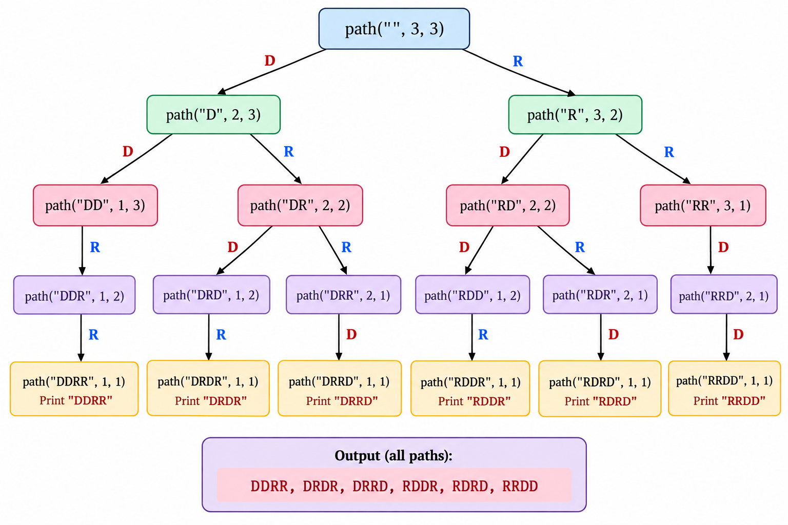

# Maze Path Problem — Recursion Explanation in Java

Your code solves the Maze Path Counting problem using recursion.

The goal is to count how many different paths exist to reach the destination in a grid when you can move only Right and Down.

Let's understand why we start with `count(3, 3)`, what `row` and `column` mean, and how the recursion works.

## 1. Why do we start with `count(3, 3)`?

```java
System.out.println(count(3, 3));
```

We start with `3, 3` because we are considering a maze of 3 rows and 3 columns.

Imagine this grid:

```text
S → →
↓   ↓
↓ → D
```

- `S` = Start (top-left)
- `D` = Destination (bottom-right)

We want to move from the top-left cell to the bottom-right cell.

For a `3 × 3` grid, we must move:

- 2 steps Right
- 2 steps Down

There are different orders in which we can make these moves, so we need to count all possible paths.

**Important:** `count(3, 3)` represents the dimensions of the remaining grid, not the coordinates `(3, 3)` of a cell. Your code is using a recursive counting approach.

## 2. What do `row` and `column` mean?

```java
static int count(int row, int column)
```

Here, `row` and `column` represent the size of the grid we are considering in the recursive problem.

For example:

- `count(3, 3)` means a 3-row, 3-column problem.
- `count(2, 3)` means a 2-row, 3-column problem.
- `count(3, 2)` means a 3-row, 2-column problem.
- `count(1, 3)` means a 1-row, 3-column problem.

When we reduce `row` or `column` by one, we are moving toward a smaller subproblem.

## 3. Understand your code line by line

```java
static int count(int row, int column) {

    if (row == 1 || column == 1) {
        return 1;
    }

    int left = count(row - 1, column);
    int right = count(row, column - 1);

    return left + right;
}
```

### Step 1: Base condition

```java
if (row == 1 || column == 1) {
    return 1;
}
```

**Why do we return `1`?**

When one dimension is `1`, there is only one possible way to finish: keep moving in the remaining direction.

For example, in a `1 × 3` grid:

```text
1 → 2 → 3
```

Only one path: Right → Right.

Similarly, a `3 × 1` grid has only one path: Down → Down.

Therefore, the answer is `1`.

### Step 2: Recursive calls

```java
int left = count(row - 1, column);
int right = count(row, column - 1);
```

We divide the problem into two smaller problems.

- `count(row - 1, column)` reduces the number of rows by one.
- `count(row, column - 1)` reduces the number of columns by one.

These represent the two possible directions of movement in the usual maze interpretation.

### Step 3: Add both answers

```java
return left + right;
```

We add the number of paths from both smaller problems because each represents a different possible first move.

This gives us the recurrence:

$$
f(r,c)=f(r-1,c)+f(r,c-1)
$$

With the base case:

$$
f(r,c)=1 \quad \text{if } r=1 \text{ or } c=1
$$

## 4. Complete recursion tree for `count(3, 3)`

Let's trace exactly how the calls execute.

```text
count(3, 3)
    ├── left  → count(2, 3)
    └── right → count(3, 2)
```

Each call branches again until a dimension becomes `1`.

### Calculate `count(2, 3)`

```text
count(2, 3)
    ├── count(1, 3) = 1
    └── count(2, 2) = 2
```

Therefore:

```text
count(2, 3)
= count(1, 3) + count(2, 2)
= 1 + 2
= 3
```

### Calculate `count(3, 2)`

```text
count(3, 2)
    ├── count(2, 2) = 2
    └── count(3, 1) = 1
```

Therefore:

```text
count(3, 2)
= count(2, 2) + count(3, 1)
= 2 + 1
= 3
```

### Final result

**6 paths**

Thus:

$$
\begin{aligned}
f(3,3)&=f(2,3)+f(3,2)\\
&=3+3\\
&=\boxed{6}
\end{aligned}
$$

Your program prints:

```text
6
```

## 5. What is the overall approach?

Remember these four points:

1. **Start:** `count(3, 3)` defines the size of the original problem.
2. **Break down:** Reduce either the row or column dimension to represent one of the two possible moves.
3. **Stop:** When `row == 1` or `column == 1`, return `1`.
4. **Combine:** Add the answers from both recursive calls.

One subtle point: your code counts paths, not the actual movement sequences. It doesn't create a maze array or check blocked cells; it assumes an unobstructed rectangular grid and movement in only two directions.

**Time complexity:** `O(2^(r+c))` as a simple upper bound for the recursive implementation, because it repeats many subproblems. The same problem can be optimized using dynamic programming.


## 6. recursion tree
```text 
                         count(3,3)
                        /          \
                 left /              \ right
                     /                \
              count(2,3)              count(3,2)
              /       \                /       \
             /         \              /         \
       count(1,3)  count(2,2)    count(2,2)  count(3,1)
           |          /    \          |          |
        return 1  count(1,2) count(2,1)        return 1
                      |          |
                   return 1   return 1
                      \          /
                       \        /
                       count(2,2) = 2
```

# Print Maze Paths — Recursion and Backtracking in Java

Your code prints all possible paths from the top-left corner to the bottom-right corner of a maze, assuming you can move only Down (`D`) and Right (`R`).

The most important thing to understand is that this problem uses recursion with two choices at each step. It is closely related to decision-tree recursion, not directly to the usual subsequence or permutation patterns.

## 1. First, understand the maze

You call:

```java
path("", 3, 3);
```

This means:

- `p = ""` — the path is initially empty.
- `row = 3` — there are 3 rows remaining.
- `column = 3` — there are 3 columns remaining.

Imagine a `3 × 3` grid:

```text
S  ·  ·
·  ·  ·
·  ·  D
```

- `S` = Start
- `D` = Destination

To reach the destination, you need exactly:

- 2 Down moves (`D`)
- 2 Right moves (`R`)

The possible movement sequences are:

- `DDRR`
- `DRDR`
- `DRRD`
- `RDDR`
- `RDRD`
- `RRDD`

Therefore, your code prints 6 paths.

## 2. Which approach does this code use?

| Algorithm pattern | Is it used here? | Why? |
|---|---|---|
| Recursion | Yes | The method calls itself with smaller dimensions. |
| Decision-tree recursion | Yes | Each call can choose Down or Right. |
| Backtracking | Related, but no explicit undo | Each recursive call explores a separate path; the path string is immutable. |
| Subsequences | No, not directly | You aren't deciding whether to include or exclude each element of an input array. |
| Permutations | Not the standard pattern | You aren't freely arranging distinct elements; you are arranging a fixed number of `D` and `R` moves subject to the maze rules. |

The best classification is: **recursive path generation using a decision tree.**

It has a similar branching structure to subsequence and permutation problems, but the choices and constraints are different.

## 3. Complete recursive tree for `path("", 3, 3)`

Let's trace every recursive call. Your code checks Down first (`D`) and Right second (`R`), so the tree explores all Down-first branches before the Right-first branches.

```text
path("", 3, 3)
│
├── D → path("D", 2, 3)
│   │
│   ├── D → path("DD", 1, 3)
│   │   │
│   │   └── R → path("DDR", 1, 2)
│   │       │
│   │       └── R → path("DDRR", 1, 1)
│   │           └── PRINT "DDRR"
│   │
│   └── R → path("DR", 2, 2)
│       │
│       ├── D → path("DRD", 1, 2)
│       │   │
│       │   └── R → path("DRDR", 1, 1)
│       │       └── PRINT "DRDR"
│       │
│       └── R → path("DRR", 2, 1)
│           │
│           └── D → path("DRRD", 1, 1)
│               └── PRINT "DRRD"
│
└── R → path("R", 3, 2)
    │
    ├── D → path("RD", 2, 2)
    │   │
    │   ├── D → path("RDD", 1, 2)
    │   │   │
    │   │   └── R → path("RDDR", 1, 1)
    │   │       └── PRINT "RDDR"
    │   │
    │   └── R → path("RDR", 2, 1)
    │       │
    │       └── D → path("RDRD", 1, 1)
    │           └── PRINT "RDRD"
    │
    └── R → path("RR", 3, 1)
        │
        └── D → path("RRD", 2, 1)
            │
            └── D → path("RRDD", 1, 1)
                └── PRINT "RRDD"
```

Every leaf reaches `(1, 1)`, so the path is printed.

### Output

```text
DDRR
DRDR
DRRD
RDDR
RDRD
RRDD
```

## 4. Understand the code line by line

### A. The initial call

```java
path("", 3, 3);
```

We start with an empty path because we haven't moved yet.

The recursion gradually builds the path by appending `D` or `R`.

### B. The base case

```java
if (row == 1 && column == 1) {
    System.out.println(p);
    return;
}
```

When both dimensions reach `1`, we have reached the destination.

We print the path accumulated so far and return to the previous recursive call.

**Why use `&&` instead of `||` here?**

Because we print a completed path only when both dimensions have reached `1`. If either dimension alone reaches `1`, movement along the other dimension may still be necessary.

### C. The Down choice

```java
if (row > 1) {
    path(p + 'D', row - 1, column);
}
```

If more than one row remains, we can move Down.

For example:

```java
path("", 3, 3);
```

makes this recursive call:

```java
path("D", 2, 3);
```

Notice two changes:

- `p + 'D'` changes the path from `""` to `"D"`.
- `row - 1` changes the remaining row dimension from `3` to `2`.

### D. The Right choice

```java
if (column > 1) {
    path(p + 'R', row, column - 1);
}
```

If more than one column remains, we can move Right.

For example:

```java
path("", 3, 3);
```

also makes this call:

```java
path("R", 3, 2);
```

The path becomes `"R"`, and the column dimension decreases by one.

**Important:** Both `if` statements are independent. We don't use `else` because both choices must be explored to generate all possible paths.

## 5. Why don't we need an undo statement?

Compare this with N-Queens:

```java
board[row][col] = 'Q';
solve(...);
board[row][col] = '.';
```

In N-Queens, we modify a shared board, so we must undo the modification.

Your maze code instead uses:

```java
path(p + 'D', row - 1, column);
```

Java creates a new `String` for `p + 'D'`. The original `p` remains unchanged.

For example, if the current path is `"D"`:

- Down creates `"DD"`.
- Right creates `"DR"`.

The two branches do not overwrite each other's paths. Therefore, no explicit undo statement is required.

## 6. How is this related to subsequences and permutations?

Consider these three patterns:

### Maze paths

Choose a valid direction at each step.

`D` or `R` → explore the remaining maze.

### Subsequences

Decide whether to include an element.

`Take` or `Skip` → process the next element.

### Permutations

Choose an unused element for the next position.

`Choose` → recurse → `Undo` the selection.

All three can use recursion trees. What changes is the meaning of the choices.

For a `3 × 3` maze, every complete path contains exactly two `D` moves and two `R` moves. Thus, the number of paths is also:

$$
\binom{4}{2}=\frac{4!}{2!\,2!}=6
$$

This combinatorial formula gives the same result, but your code obtains it by exploring the recursive tree.

## 7. Complexity

For a maze with \(r\) rows and \(c\) columns, where only Down and Right are allowed:

- **Time complexity:** \(O\left(\binom{r+c-2}{r-1}(r+c)\right)\) when accounting for constructing and printing each complete path, using a straightforward string-based implementation.
- **Auxiliary recursion depth:** \(O(r+c)\), excluding the output.

Remember the key distinction: Your code doesn't search a maze with obstacles. It generates all valid Down/Right movement sequences for an unobstructed rectangular grid.

## Recursion Tree



## Recursion Tree for printAllMazePath.java
```text
path("", 0, 0) [MARK F: (0,0)]
│
├── D: path("D", 1, 0) [MARK F: (1,0)]
│   │
│   ├── D: path("DD", 2, 0) [MARK F: (2,0)]
│   │   │
│   │   ├── D: out of bounds
│   │   ├── R: path("DDR", 2, 1) [MARK F: (2,1)]
│   │   │   │
│   │   │   ├── D: out of bounds
│   │   │   ├── R: path("DDRR", 2, 2)
│   │   │   │   └── PRINT "DDRR"; RETURN
│   │   │   │
│   │   │   ├── U: path("DDRU", 1, 1) [MARK F: (1,1)]
│   │   │   │   │
│   │   │   │   ├── D: (2,1) is false → RETURN
│   │   │   │   ├── R: path("DDRUR", 1, 2) [MARK F: (1,2)]
│   │   │   │   │   │
│   │   │   │   │   ├── D: path("DDRURD", 2, 2)
│   │   │   │   │   │   └── PRINT "DDRURD"; RETURN
│   │   │   │   │   ├── R: out of bounds
│   │   │   │   │   ├── U: path("DDRURU", 0, 2) [MARK F: (0,2)]
│   │   │   │   │   │   │
│   │   │   │   │   │   ├── D: (1,2) is false → RETURN
│   │   │   │   │   │   ├── R: out of bounds
│   │   │   │   │   │   ├── U: out of bounds
│   │   │   │   │   │   └── L: path("DDRURUL", 0, 1) [MARK F: (0,1)]
│   │   │   │   │   │       ├── D: (1,1) is false → RETURN
│   │   │   │   │   │       ├── R: (0,2) is false → RETURN
│   │   │   │   │   │       ├── U: out of bounds
│   │   │   │   │   │       └── L: (0,0) is false → RETURN
│   │   │   │   │   │       RESTORE (0,1) = true
│   │   │   │   │   │       ↩ RETURN to path("DDRURU", 0, 2)
│   │   │   │   │   │
│   │   │   │   │   RESTORE (0,2) = true
│   │   │   │   │   ↩ RETURN to path("DDRUR", 1, 2)
│   │   │   │   ├── L: (1,1) is false → RETURN
│   │   │   │   RESTORE (1,2) = true
│   │   │   │   ↩ RETURN to path("DDRU", 1, 1)
│   │   │   │
│   │   │   ├── U: path("DDRUU", 0, 1) [MARK F: (0,1)]
│   │   │   │   │
│   │   │   │   ├── D: (1,1) is false → RETURN
│   │   │   │   ├── R: path("DDRUUR", 0, 2) [MARK F: (0,2)]
│   │   │   │   │   │
│   │   │   │   │   ├── D: path("DDRUURD", 1, 2) [MARK F: (1,2)]
│   │   │   │   │   │   └── D: path("DDRUURDD", 2, 2)
│   │   │   │   │   │       └── PRINT "DDRUURDD"; RETURN
│   │   │   │   │   │       RESTORE (1,2) = true
│   │   │   │   │   │       ↩ RETURN to path("DDRUUR", 0, 2)
│   │   │   │   │   ├── R: out of bounds
│   │   │   │   │   ├── U: out of bounds
│   │   │   │   │   └── L: (0,1) is false → RETURN
│   │   │   │   │
│   │   │   │   RESTORE (0,2) = true
│   │   │   │   ↩ RETURN to path("DDRUU", 0, 1)
│   │   │   │
│   │   │   └── L: (2,0) is false → RETURN
│   │   │   RESTORE (1,1) = true
│   │   │   ↩ RETURN to path("DDR", 2, 1)
│   │   │
│   │   └── L: (2,0) is false → RETURN
│   │   RESTORE (2,1) = true
│   │   ↩ RETURN to path("DD", 2, 0)
│   │
│   ├── R: path("DR", 1, 1) [MARK F: (1,1)]
│   │   │
│   │   ├── D: path("DRD", 2, 1) [MARK F: (2,1)]
│   │   │   ├── D: out of bounds
│   │   │   ├── R: path("DRDR", 2, 2)
│   │   │   │   └── PRINT "DRDR"; RETURN
│   │   │   ├── U: (1,1) is false → RETURN
│   │   │   └── L: path("DRDL", 2, 0) [MARK F: (2,0)]
│   │   │       ├── D: out of bounds
│   │   │       ├── R: (2,1) is false → RETURN
│   │   │       ├── U: (1,0) is false → RETURN
│   │   │       └── L: out of bounds
│   │   │       RESTORE (2,0) = true
│   │   │       ↩ RETURN to path("DRD", 2, 1)
│   │   │   RESTORE (2,1) = true
│   │   │   ↩ RETURN to path("DR", 1, 1)
│   │   │
│   │   ├── R: path("DRR", 1, 2) [MARK F: (1,2)]
│   │   │   ├── D: path("DRRD", 2, 2)
│   │   │   │   └── PRINT "DRRD"; RETURN
│   │   │   ├── R: out of bounds
│   │   │   ├── U: path("DRRU", 0, 2) [MARK F: (0,2)]
│   │   │   │   ├── D: (1,2) is false → RETURN
│   │   │   │   ├── R: out of bounds
│   │   │   │   ├── U: out of bounds
│   │   │   │   └── L: path("DRRUL", 0, 1) [MARK F: (0,1)]
│   │   │   │       ├── D: (1,1) is false → RETURN
│   │   │   │       ├── R: (0,2) is false → RETURN
│   │   │   │       ├── U: out of bounds
│   │   │   │       └── L: (0,0) is false → RETURN
│   │   │   │       RESTORE (0,1) = true
│   │   │   │       ↩ RETURN to path("DRRU", 0, 2)
│   │   │   │   RESTORE (0,2) = true
│   │   │   └── L: (1,1) is false → RETURN
│   │   │   RESTORE (1,2) = true
│   │   │   ↩ RETURN to path("DR", 1, 1)
│   │   │
│   │   ├── U: (0,1) is false → RETURN
│   │   └── L: (1,0) is false → RETURN
│   │   RESTORE (1,1) = true
│   │   ↩ RETURN to path("D", 1, 0)
│   │
│   ├── U: out of bounds
│   └── L: out of bounds
│   RESTORE (1,0) = true
│   ↩ RETURN to path("", 0, 0)
│
└── R: path("R", 0, 1) [MARK F: (0,1)]
    │
    ├── D: path("RD", 1, 1) [MARK F: (1,1)]
    │   ├── D: path("RDD", 2, 1) [MARK F: (2,1)]
    │   │   ├── D: out of bounds
    │   │   ├── R: path("RDDR", 2, 2)
    │   │   │   └── PRINT "RDDR"; RETURN
    │   │   ├── U: (1,1) is false → RETURN
    │   │   └── L: path("RDDL", 2, 0) [MARK F: (2,0)]
    │   │       ├── D: out of bounds
    │   │       ├── R: (2,1) is false → RETURN
    │   │       ├── U: path("RDDLU", 1, 0) [MARK F: (1,0)]
    │   │       │   ├── D: (2,0) is false → RETURN
    │   │       │   ├── R: (1,1) is false → RETURN
    │   │       │   ├── U: (0,0) is true → path("RDDLUU", 0, 0)
    │   │       │   └── L: out of bounds
    │   │       │   RESTORE (1,0) = true
    │   │       │   ↩ RETURN to path("RDDL", 2, 0)
    │   │       └── L: out of bounds
    │   │       RESTORE (2,0) = true
    │   │   RESTORE (2,1) = true
    │     │   ↩ RETURN to path("RD", 1, 1)
    │   │
    │   ├── R: path("RDR", 1, 2) [MARK F: (1,2)]
    │   │   ├── D: path("RDRD", 2, 2)
    │   │   │   └── PRINT "RDRD"; RETURN
    │   │   ├── R: out of bounds
    │   │   ├── U: path("RDRU", 0, 2) [MARK F: (0,2)]
    │   │   │   ├── D: (1,2) is false → RETURN
    │   │   │   ├── R: out of bounds
    │   │   │   ├── U: out of bounds
    │   │   │   └── L: (0,1) is false → RETURN
    │   │   │   RESTORE (0,2) = true
    │   │   │   ↩ RETURN to path("RDR", 1, 2)
    │   │   └── L: (1,1) is false → RETURN
    │   │   RESTORE (1,2) = true
    │   │
    │   ├── U: (0,1) is false → RETURN
    │   └── L: (1,0) is false → RETURN
    │   RESTORE (1,1) = true
    │
    ├── R: path("RR", 0, 2) [MARK F: (0,2)]
    │   ├── D: path("RRD", 1, 2) [MARK F: (1,2)]
    │   │   ├── D: path("RRDD", 2, 2)
    │   │   │   └── PRINT "RRDD"; RETURN
    │   │   ├── R: out of bounds
    │   │   ├── U: (0,2) is false → RETURN
    │   │   └── L: path("RRDL", 1, 1) [MARK F: (1,1)]
    │   │       ├── D: (2,1) is true → path("RRDLD", 2, 1)
    │   │       │   ├── D: out of bounds
    │   │       │   ├── R: (2,2) → PRINT "RRDLDR"
    │   │       │   ├── U: (1,1) is false → RETURN
    │   │       │   └── L: path("RRDLDL", 2, 0) [MARK F: (2,0)]
    │   │       │       ├── D: out of bounds
    │   │       │       ├── R: (2,1) is false → RETURN
    │   │       │       ├── U: (1,0) is true → path("RRDLDLU", 1, 0)
    │   │       │       └── L: out of bounds
    │   │       │       RESTORE (2,0) = true
    │   │       │   RESTORE (2,1) = true
    │   │       ├── R: (1,2) is false → RETURN
    │   │       ├── U: (0,1) is false → RETURN
    │   │       └── L: path("RRDLL", 1, 0) [MARK F: (1,0)]
    │   │           ├── D: (2,0) is true → path("RRDLLD", 2, 0)
    │   │           ├── R: (1,1) is false → RETURN
    │   │           ├── U: (0,0) is true → path("RRDLLU", 0, 0)
    │   │           └── L: out of bounds
    │   │           RESTORE (1,0) = true
    │   │       RESTORE (1,1) = true
    │   │   RESTORE (1,2) = true
    │   └── L: (0,1) is false → RETURN
    │   RESTORE (0,2) = true
    │
    ├── U: out of bounds
    └── L: (0,0) is false → RETURN
    RESTORE (0,1) = true
    ↩ RETURN to path("", 0, 0)

RESTORE (0,0) = true
↩ END
---
[1, 0, 0]
[2, 0, 0]
[3, 4, 5]
DDRR

[1, 0, 0]
[2, 5, 6]
[3, 4, 7]
DDRURD

[1, 6, 7]
[2, 5, 8]
[3, 4, 9]
DDRUURDD

[1, 0, 0]
[2, 3, 0]
[0, 4, 5]
DRDR

[1, 0, 0]
[2, 3, 4]
[0, 0, 5]
DRRD

[1, 4, 5]
[2, 3, 6]
[0, 0, 7]
DRURDD

[1, 2, 0]
[0, 3, 0]
[0, 4, 5]
RDDR

[1, 2, 0]
[0, 3, 4]
[0, 0, 5]
RDRD

[1, 2, 0]
[4, 3, 0]
[5, 6, 7]
RDLDRR

[1, 2, 3]
[0, 0, 4]
[0, 0, 5]
RRDD

[1, 2, 3]
[0, 5, 4]
[0, 6, 7]
RRDLDR

[1, 2, 3]
[6, 5, 4]
[7, 8, 9]
RRDLLDRR
```

## uniquePaths — Complete Explanation

Your program uses **recursion, backtracking, and in-place visited-cell tracking** to find all valid paths from the starting cell to the destination in a grid.

Unlike the previous version, this implementation does not use a separate `boolean[][] maze` matrix. Instead, it temporarily modifies the original `grid` to mark visited cells and restores their original values after exploring each path.

We'll understand the problem first, then the approach, code execution, recursion, backtracking, and time and space complexity.

## 1. What is the problem?

You are given a 2D grid containing four types of cells:

| Value | Meaning |
|---|---|
| `1` | Starting cell |
| `0` | Empty cell |
| `2` | Destination cell |
| `-1` | Obstacle — cannot enter |

You must find the number of paths from the starting cell to the destination such that **every non-obstacle cell is visited exactly once**.

You can move in four directions:

- **Down:** `row + 1`
- **Up:** `row - 1`
- **Right:** `column + 1`
- **Left:** `column - 1`

Your input grid is:

```java
int[][] grid = {
    { 1, 0, 0, 0 },
    { 0, 0, 0, 0 },
    { 0, 0, 2, -1 }
};
```

There are 12 cells in total. One cell is an obstacle, so there are **11 non-obstacle cells**.

Therefore, a valid path must visit all 11 non-obstacle cells exactly once, including the starting and destination cells.

Since the starting cell is counted as step 1, the destination must be reached at **step 11**.

## 2. What is the approach?

Your approach is **Depth-First Search (DFS) with backtracking**.

The algorithm explores one possible route as far as it can, then returns to earlier cells to try alternative routes.

The basic process is:

1. Find the starting cell (`1`) and count all non-obstacle cells.
2. Start recursion from the starting cell with `steps = 1`.
3. Save the original value of the current cell.
4. Temporarily change the current cell to `-1` to mark it as visited.
5. Explore Down, Right, Up, and Left wherever movement is allowed.
6. When the destination (`2`) is reached, accept the route only if `steps == totalCells`.
7. Restore the original value of the current cell after exploring all directions.

The crucial distinction is that **reaching the destination does not automatically make a route valid**. Every non-obstacle cell must have been visited first.

## 3. Understand the `main()` method

### Step 1: Create the grid

```java
int[][] grid = {
    { 1, 0, 0, 0 },
    { 0, 0, 0, 0 },
    { 0, 0, 2, -1 }
};
```

This represents the actual maze. The values tell us which cell is the start, destination, empty, or obstacle.

### Step 2: Create the `path` matrix

```java
int[][] path = new int[grid.length][grid[0].length];
```

This matrix records the order in which cells are visited.

For example, a cell visited as the first cell gets `1`, the next gets `2`, and so on.

It is used only to visualize the path. It is not required to calculate the answer.

### Step 3: Count all required cells and find the start

```java
int totalCells = 0;
int startRow = 0;
int startCol = 0;

for (int r = 0; r < grid.length; r++) {
    for (int c = 0; c < grid[0].length; c++) {
        if (grid[r][c] != -1) {
            totalCells++;
        }

        if (grid[r][c] == 1) {
            startRow = r;
            startCol = c;
        }
    }
}
```
## Why Do We Use `totalCells` and `steps == totalCells`?
these two variables ensure that **every non-obstacle cell is visited exactly once before reaching the destination**.

### 1. Why Do We Use `totalCells`?

```java
int totalCells = 0;

for (int r = 0; r < grid.length; r++) {
    for (int c = 0; c < grid[0].length; c++) {
        if (grid[r][c] != -1) {
            totalCells++;
        }
    }
}
```

`totalCells` stores the total number of cells that must be visited. We exclude obstacles (`-1`) because they cannot be visited.

For your grid:

```java
int[][] grid = {
    { 1, 0, 0, 0 },
    { 0, 0, 0, 0 },
    { 0, 0, 2, -1 }
};
```

There are 12 cells in total, but one is an obstacle.


These 11 cells include:

- 1 starting cell
- 9 empty cells
- 1 destination cell

### 2. Why Do We Start `steps` at `1`?

Your recursive call is:

```java
int count = allPath(
    "", path, grid,
    startRow, startCol, 1, totalCells
);
```

We start `steps` at `1` because the starting cell itself counts as the first visited cell.

Suppose a route visits the cells in this order:

| Step | Meaning |
|---:|---|
| 1 | Starting cell |
| 2 | Second cell visited |
| 3 | Third cell visited |
| ... | ... |
| 11 | Eleventh cell visited |

This continues until the destination is reached.

Whenever you move to another cell, you pass:

```java
steps + 1
```

For example:

```java
allPath(
    p + 'D', path, grid,
    row + 1, column, steps + 1, totalCells
);
```

So, `steps` represents the **number of cells visited along the current route**, including the current cell. It does not represent the number of moves.

### 3. Why Do We Check `steps == totalCells`?

Your destination condition is:

```java
if (grid[row][column] == 2) {
    if (steps == totalCells) {
        return 1;
    } else {
        return 0;
    }
}
```

This condition checks whether the route visited every required cell before reaching the destination.

For your grid, `totalCells = 11`.

| When the destination is reached | `steps` | Result |
|---|---:|---|
| An incomplete route | 5 | `return 0` |
| An incomplete route | 8 | `return 0` |
| After visiting every required cell | 11 | `return 1` |

**Why reject a route that reaches the destination at step 8?**

Because three required cells would remain unvisited. Even though the destination was reached, the route does not satisfy the problem's conditions.

### 4. How Do These Two Variables Work Together?

The relationship is simple:

- `totalCells` tells us how many cells must be visited.
- `steps` tells us how many cells have been visited on the current route.
- `steps == totalCells` confirms that the entire route has covered every required cell when it reaches the destination.

The recursive calls increment `steps` as they move, while `totalCells` stays constant.

\[
\boxed{\text{Valid path: destination reached and steps}=\text{totalCells}}
\]

**Remember:** We use `totalCells` as the target and `steps` as the current progress. Together, they prevent the algorithm from counting paths that reach the destination too early.

The condition `grid[r][c] != -1` excludes obstacles from the count.

For your grid:

- Empty cells: 9
- Starting cell: 1
- Destination cell: 1
- Obstacle cells: 1
- Total required cells: **11**

The starting coordinates are `(0, 0)`.

### Step 4: Call the recursive function

```java
int count = allPath(
    "", path, grid,
    startRow, startCol, 1, totalCells
);

System.out.println(count);
```

The arguments mean:

| Argument | Purpose |
|---|---|
| `""` | Initially, the path string is empty |
| `path` | Stores the visit order for printing |
| `grid` | Stores the maze and tracks visited cells |
| `startRow`, `startCol` | Starting coordinates |
| `1` | The start is step 1 |
| `totalCells` | Number of cells that must be visited |

Notice that the `maze` matrix is no longer passed to the function. Your code uses `grid` itself to track visited cells.

## 4. Understand the `allPath()` method

### A. Reject an obstacle or visited cell

```java
if (grid[row][column] == -1) {
    return 0;
}
```

If the current cell contains `-1`, the route cannot continue.

This condition handles two situations:

- A permanent obstacle that was already present in the input.
- A cell that was temporarily marked as visited by the current recursive route.

`return 0` means this recursive branch contributes zero valid paths.

### B. Check whether the destination has been reached

```java
if (grid[row][column] == 2) {
    if (steps == totalCells) {
        path[row][column] = steps;

        for (int[] arr : path) {
            System.out.println(Arrays.toString(arr));
        }

        System.out.println(p);
        System.out.println();

        return 1;
    } else {
        return 0;
    }
}
```

This is the most important condition in the program.

- If the destination is reached after visiting every required cell, return `1`.
- Otherwise, return `0`.

Why return `1`? Because the method counts valid routes. Every valid completed route contributes one to the total count.

For your grid, a route reaching the destination at step 11 is valid. If it reaches the destination at step 8, it is invalid because some cells remain unvisited.

### C. Save the original value and mark the current cell

```java
int count = 0;

int original = grid[row][column];
grid[row][column] = -1;

path[row][column] = steps;
```

Before exploring the next cells:

- `count = 0` initializes the number of valid paths found from this position.
- `original` saves the current cell's original value.
- `grid[row][column] = -1` temporarily marks the cell as visited.
- `path[row][column] = steps` records the current step number.

The cell remains marked as visited while all four directions are explored.

### Why do we use `int original` instead of `boolean[][] maze`?

In the previous implementation, you used a separate matrix:

```java
boolean[][] maze = new boolean[grid.length][grid[0].length];
```

You marked a cell as visited using:

```java
maze[row][column] = false;
```

In your updated code, you modify the original grid instead:

```java
int original = grid[row][column];
grid[row][column] = -1;
```

Suppose the current cell contains `0`.

Before visiting:

```text
grid[row][column] = 0
```

After marking it visited:

```text
grid[row][column] = -1
```

After exploring all directions:

```java
grid[row][column] = original;
```

The cell becomes `0` again.

The variable `original` is necessary because the cell might originally contain `0` or `1`. You must restore its actual previous value, not always set it to `0`.

| Feature | Separate `boolean[][] maze` | Reusing `grid` with `int original` |
|---|---|---|
| Mark visited | `maze[row][column] = false` | `grid[row][column] = -1` |
| Restore state | `maze[row][column] = true` | `grid[row][column] = original` |
| Extra visited matrix | Required | Not required |
| Original grid during recursion | Unmodified | Temporarily modified |
| Additional space | One extra matrix | No extra visited matrix |

Both approaches are correct. Reusing `grid` is more space-efficient because it eliminates the separate visited matrix.

### D. Explore all four directions

```java
if (row < grid.length - 1) {
    count += allPath(
        p + 'D', path, grid,
        row + 1, column, steps + 1, totalCells
    );
}
```

This explores Down, provided the next row is within the grid.

The other three calls follow the same logic:

```java
// Right
if (column < grid[0].length - 1) {
    count += allPath(
        p + 'R', path, grid,
        row, column + 1, steps + 1, totalCells
    );
}

// Up
if (row > 0) {
    count += allPath(
        p + 'U', path, grid,
        row - 1, column, steps + 1, totalCells
    );
}

// Left
if (column > 0) {
    count += allPath(
        p + 'L', path, grid,
        row, column - 1, steps + 1, totalCells
    );
}
```

Each call explores a separate choice. The boundary checks prevent the recursion from moving outside the grid.

**Why use `count +=`?**

Suppose the Down branch finds 2 valid routes and the Right branch finds 3. Their combined contribution is:

\[
count = 2 + 3 = 5
\]

Every recursive call returns the number of valid routes found beneath that call.

### E. Backtrack and restore the state

```java
grid[row][column] = original;
path[row][column] = 0;

return count;
```

Once all directions have been explored, the function restores the current cell.

This is **backtracking**: undoing the current choice after exploring its consequences so that another route can use that cell.

For example:

1. Visit cell `(0, 0)` and save its original value, `1`.
2. Change the cell to `-1`.
3. Explore all possible routes starting from it.
4. Finish exploring those routes.
5. Restore `(0, 0)` to `1`.
6. Return the number of valid routes found.

Without restoration, other branches could incorrectly treat the cell as permanently unavailable.

**Important correction for path printing:** Your current code returns immediately when a valid destination is reached, leaving the destination's step number in `path`. If you want every printed matrix to represent only its own route, copy the matrix before printing or restore the destination cell after printing. Otherwise, a previously printed route's destination step may remain visible in later outputs.

## 5. Visualize the recursion

Suppose the algorithm starts at the top-left cell. It explores a tree of choices:

```text
Start (0, 0)
    |
    ├── Down
    |     └── Continue DFS
    |
    └── Right
          └── Continue DFS
```

The actual recursion tree is much larger because each cell can have up to four possible directions. Visited-cell tracking eliminates moves back into cells already used by the current route.

Your code explores Down before Right, then Up, then Left. Consequently, the order of the printed paths depends on this direction order.

## 6. Why are both `grid` and `path` used?

They serve different purposes.

| Matrix | Purpose | Required for counting? |
|---|---|---|
| `grid` | Represents the maze and tracks visited cells | Yes |
| `path` | Displays the order of visited cells | No |

Your current implementation is useful for learning because it separates the maze's cell information from the path visualization, while avoiding a separate visited matrix.

For a count-only solution, you can remove `path` and the path string `p` as well.

## 7. Complexity analysis

Let \(M\) be the number of non-obstacle cells.

- **Time complexity:** \(O(4^M)\) as a loose upper-bound estimate, because each visited cell can lead to up to four recursive choices. The visited-cell restriction makes the actual search smaller than this bound.
- **Auxiliary space complexity:** \(O(M)\) for the recursion stack, plus \(O(M)\) for the `path` matrix. The grid itself is input storage, although its cells are temporarily modified.

Your updated implementation saves the extra `boolean[][] maze` matrix.

## 8. Important concepts to remember

1. **DFS:** Explore one route deeply before trying another.
2. **Backtracking:** Restore the current state after exploring a route.
3. **Visited tracking:** Temporarily replace the current cell with `-1` to prevent revisiting it.
4. **Saving original state:** Store the cell's original value in `int original` so it can be restored correctly.
5. **Base cases:** Stop when an obstacle or visited cell is encountered, or when the destination is reached.
6. **Counting recursion:** Invalid branches return `0`; valid complete routes return `1`; parent calls add their children's results.
7. **Path visualization:** `path` records the order of cells but does not determine whether the route is valid.

The central idea is: **save the current cell, mark it visited, explore every possible continuation, restore the original value, and count only routes that visit every required cell exactly once.**